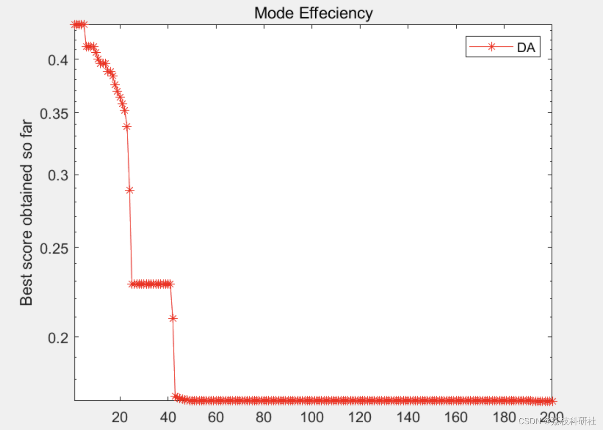
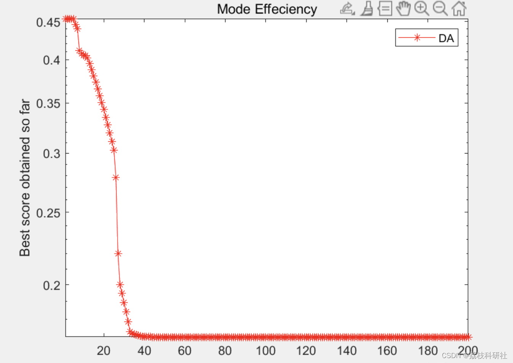
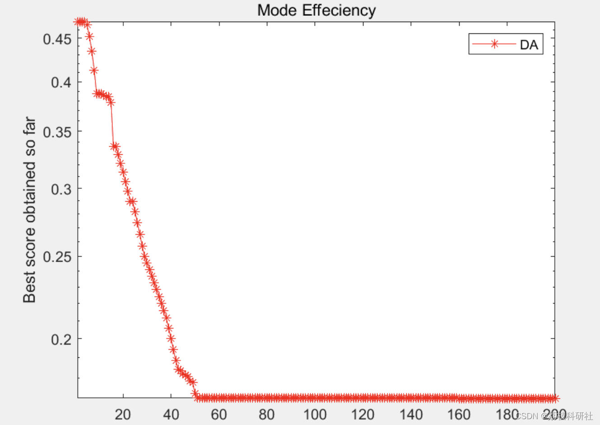

# Research on Quality of Service in Cognitive Radio Network Based on Dragonfly Optimization Algorithm (Matlab Code Implementation)

🏆 Bloggers' Advantage: 🌞🌞🌞 The content of the blog is as meticulous as possible, with clear logic for the convenience of readers.
⛳️ Mantra: A journey of a thousand miles is made in ninety days.
📋📋📋 Table of Contents: 🎁🎁🎁 Title: 1 Overview📚 2 Run Results🎉 3 References🌈 4 MATLAB Code Implementation
​Edit:💥 1 Overview Cognitive Radio Technology (CR) is an emerging technology that solves the problem of spectrum scarcity. CR has the ability to detect and learn the environment, and can intelligently adjust its parameters to provide users with the best service. In this article, we introduce a new algorithm called Dragonfly Algorithm. This algorithm is used to adapt transmission parameters and optimize service quality. The Dragonfly Algorithm (DA) is a new metaheuristic optimization algorithm based on the behavior of dragonfly flocks. The algorithm is developed according to the hunting and migratory strategies of dragonflies. This hunting technique is known as static bee colony (predation), in which all members of the bee colony can fly together over a small area to find food sources. The dragonfly's migratory strategy is called dynamic bee colony (migration). At this stage, dragonflies are willing to fly in larger groups, so the bee colony can migrate. The algorithm optimizes QoS performance from aspects such as minimum power consumption, bit error rate, maximum throughput, minimum interference, and maximum spectral efficiency. The results obtained were compared with other two algorithms, Genetic Algorithm (GA) and Simulated Annealing (SA).
📚 2 Run Results
​Edit: 
part of the code: 
power_max = 251; %maximum power in 251mW - 24dB  
power_min = 0.158; %minimum power in 0.158mW -8dB  
bandwidth_max = 32; %maximum bandwidth in Hz  
bandwidth_min = 2; %minimum bandwidth in Hz
tdd_min = 25; %minimum time for transmitting  
tdd_max = 100; %maximum time for transmitting  
Mmax = 256; %maximum of modulation index  
Mmin = 2; %minimum of modulation index  
Rs_max = 125000; % Maximum symbol rate (Symbols / second)  
Rs_min = 125;  
P_Noise_max =3.9810717055e-11 ;%dBm   -104    en 3.9810717055e-11mW 6.3095734448e-12 en dBm -112  
P_Noise_min = 3.9810717055e-12; %dBm   - 114     en 3.9810717055e-12mW 1.995262315e-12 en dBm -117  
%Pbe  
Pbe_max = 0.5768;  
Pbe_min = 0.2065;  
Pbe_mean =0.2452;  
%ub = [power_max, Mmax, bandwidth_max, tdd_max, P_Noise_max, Rs_max];  
%lb = [power_min, Mmin, bandwidth_min, tdd_min , P_Noise_max, Rs_min ];  
%ub = [power_max, Mmax, bandwidth_max, tdd_max, Pbe_max, Rs_max];  
%lb = [power_min, Mmin, bandwidth_min, tdd_min , Pbe_min, Rs_min ];  
ub = [power_max, Mmax, bandwidth_max, tdd_max, Rs_max];  
lb = [power_min, Mmin, bandwidth_min, tdd_min , Rs_min];  
%ub = [power_max, P_Noise_max, bandwidth_max, tdd_max, Rs_max];  
%lb = [power_min, P_Noise_min, bandwidth_min, tdd_min , Rs_min ];  
%ub = [power_max, Mmax, bandwidth_max, tdd_max];  
%lb = [power_min, Mmin, bandwidth_min, tdd_min];  
%ub = 166717.99945;  
%lb = 20817.8311;  
%ub=[power_max,bandwidth_max,Mmax, tdd_max , P_Noise_max, Rs_max] ;  
%lb= [power_min,bandwidth_min,Mmin, tdd_min , P_Noise_min, Rs_min] ;  
%ub=[power_max,power_max,bandwidth_max,bandwidth_max,Mmax,Mmax, tdd_max,tdd_max, P_Noise_max,P_Noise_max,Rs_max, Rs_max] ;  
%lb= [power_min,power_min,bandwidth_min,bandwidth_min,Mmin,Mmin, tdd_min ,tdd_min , P_Noise_min,P_Noise_min,Rs_min ,Rs_min] ;  
%Function_name='F20'; % Name of the test function that can be from F1 to F23 (Table 1,2,3 in the paper)  
[Best_score,Best_pos,cg_curve]=DA(SearchAgents_no,Max_iteration,lb,ub,dim,fobj);  
%figure('Position',[400 400 560 190])  
%Draw search space  
%subplot(1,2,1);  
%func_plot(Function_name);  
%title('Test function')  
%xlabel('x_1');  
%ylabel('x_2');  
%zlabel([Function_name,'( x_1 , x_2 )'])  
%grid off  
%Draw objective space;  
Semilogy(cg_curve, 'Color', 'r', 'Marker', '*')  
title('Mode Efficiency')  
xlabel('Iteration');  
ylabel('Best score obtained so far');  
axis tight  
grid off  
box on  
legend('DA')  
%a = abs(Best_score);  
display(['The best solution obtained by DA is : ', num2str(Best_pos)]);  
display(['The best optimal value of the objective function found by DA is : ',  
🎉3

## Images

<!-- PAYMENT_BLOCK -->

## Get this dataset

- Payment link (Stripe): [Buy now](https://buy.stripe.com/3cs8yP7sY87d0vu9AB)
- Payment QR code: 

<!-- /PAYMENT_BLOCK -->
